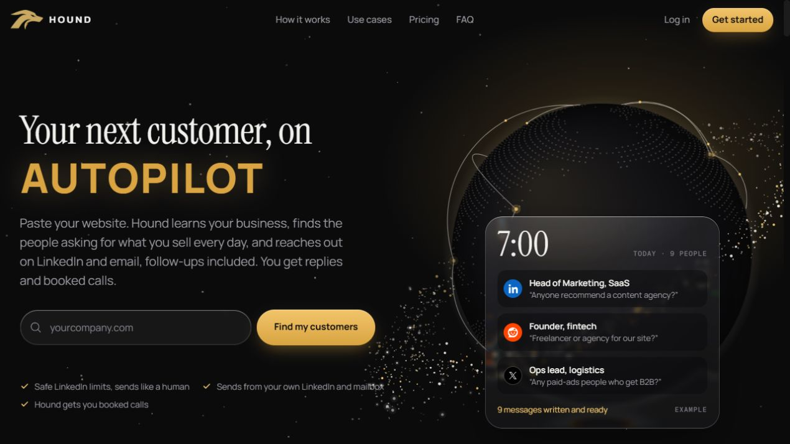
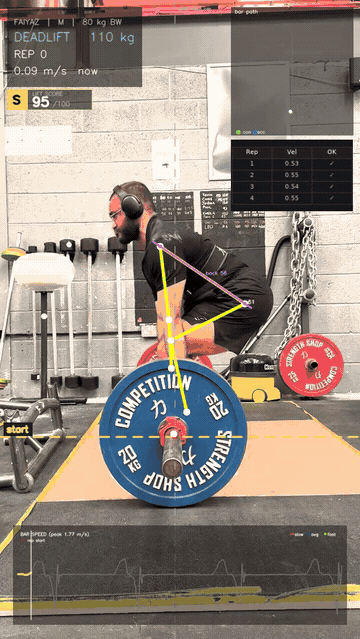

  <picture>
    <source media="(prefers-reduced-motion: reduce)" srcset="assets/hero.png" />
    
  </picture>

<h1>Things I wanted to exist.</h1>

I explore new technology and build things I want to see in the world. The ambition is to make a real difference. The space programme is taking a little longer.

  <a href="#user-content-selected-work">Selected work</a> &nbsp;·&nbsp;
  <a href="#user-content-my-journey">My journey</a> &nbsp;·&nbsp;
  <a href="#user-content-get-in-touch">Get in touch</a>

<h2></h2>

A few ideas that made it out of my head and into working software.

  

<h3>Hound</h3>

Hound searches the web every day for people talking about problems your business can solve, then helps you reach out on LinkedIn and by email. Founders have better things to do than scroll LinkedIn and X all day.

Independent build · Sales research &amp; outreach · Private source

<a href="https://www.houndreach.com/">Explore Hound ↗</a>

<h3>PowerLab</h3>

<table>
  <tr>
    <td width="38%" align="center" valign="middle">
      <a href="https://huggingface.co/spaces/Faiyaz360/Power-Lab"><picture><source media="(prefers-reduced-motion: reduce)" srcset="assets/powerlab-still.png" /></picture></a>
    </td>
    <td width="62%" valign="middle">
      
I compete in powerlifting, so I built a tool that checks lifts from a phone video: squat depth, bar path and bar speed. The bar doesn't care how convincing my excuses are.

      
Personal project · Computer vision

      
<a href="https://huggingface.co/spaces/Faiyaz360/Power-Lab">Try PowerLab ↗</a> <a href="https://github.com/Faiyaz360/Powerlab---Powerlifting-Analysis-Coach---Computer-Vision---YOLO">View source ↗</a>

    </td>
  </tr>
</table>

<a href="https://github.com/Faiyaz360/jarvis"><picture><source media="(prefers-reduced-motion: reduce)" srcset="assets/jarvis.png" /></picture></a>

<h3>Jarvis</h3>

A voice assistant for my Windows PC. It reads the screen, works with files, runs commands and answers out loud. Yes, I named it Jarvis. You saw the picture.

Personal project · Voice &amp; desktop automation

<a href="https://github.com/Faiyaz360/jarvis">Explore Jarvis ↗</a>

<h3>A few more builds</h3>

<ul>
  <li>
<strong><a href="https://github.com/Faiyaz360/ai-outbound-caller">Emma</a>.</strong> A voice-calling showcase that handles conversations, checks calendar availability and books meetings, with a dashboard for call outcomes.
</li>
  <li>
<strong><a href="https://github.com/Faiyaz360/holiday-supplier-workspace">Holiday Supplier Workspace</a>.</strong> A finance workspace for comparing hotel statements with a ledger, explaining differences with source evidence, and preparing supplier follow-up for a person to review. An independent portfolio demo using fictional records.
</li>
  <li>
<strong>ScoutMind Business OS.</strong> I built the internal workspace for planning, relationships, meetings and company documents. I also help my co-founder with the wider business. The source stays private.
</li>
</ul>

<h2></h2>

<h3>There is a person behind all these tabs.</h3>

I worked with a team rolling out factory management software, then moved into construction operations. I ran a nine-person office, worked with suppliers and contractors, and helped move accounts from paper into digital records.

Then came two Shopify stores. I sourced the products, built the stores, ran the adverts and looked after the customers. I sold one of the brands. There were quite a few hats involved.

I studied Business Management at Essex and ran practical startup workshops through the Entrepreneurship Society. These days I build across web products, voice interfaces and computer vision. Business problems get my attention. So do ideas I want to try for myself.

<h3>What's in the workshop</h3>

<table>
  <tr><th width="30%" align="left">Area</th><th width="70%" align="left">What I work with</th></tr>
  <tr><td><strong>Web products</strong></td><td>TypeScript, React, Next.js, PostgreSQL, Prisma, sign-in and billing.</td></tr>
  <tr><td><strong>Voice &amp; automation</strong></td><td>Python, FastAPI, speech recognition, streaming voice, phone and calendar integrations, background jobs.</td></tr>
  <tr><td><strong>Computer vision</strong></td><td>OpenCV, YOLO, MediaPipe, pose estimation, barbell tracking and movement analysis.</td></tr>
  <tr><td><strong>Testing &amp; deployment</strong></td><td>Pytest, Vitest, Playwright, Docker, Vercel, Railway and Google Cloud.</td></tr>
  <tr><td><strong>Business &amp; operations</strong></td><td>Supplier sourcing and negotiation, bookkeeping, process improvement, Shopify, advertising and customer research.</td></tr>
</table>

<h3>Beyond the screen</h3>

Away from the keyboard, I compete in powerlifting and read about Roman history, great leaders, business and psychology. Alexander the Great and visionary tech founders both make the reading list. I like people who look at the edge of a map and start making plans.

I read about space, too. One day, I'd like to see Earth from the other side of the atmosphere.

<picture><source media="(prefers-reduced-motion: reduce)" srcset="assets/footer.png" /></picture>

<h2>Got an idea worth getting carried away with?</h2>

  <a href="https://www.linkedin.com/in/faiyaztanvir/">LinkedIn ↗</a> &nbsp;·&nbsp;
  <a href="mailto:faiyaz360.official@gmail.com">Email ↗</a> &nbsp;·&nbsp;
  <a href="https://www.houndreach.com/">Hound ↗</a>

